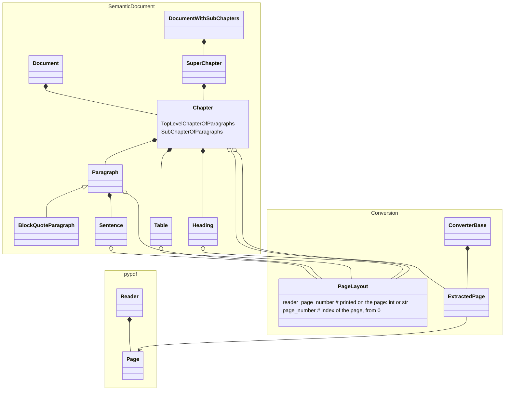

# PDF to Markdown

A Python package for converting PDF documents to Markdown format.

## Installation

```bash
pip install git+https://github.com/EricBoix/pdf-to-markdown.git
```

### macOS special instructions

On macOS with Apple Silicon the bundled `pandoc` of `pypandoc-binary` is
not usable (x86_64 only): it is not installed there and the system `pandoc` is
used instead, hence run `brew install pandoc` first.

## Usage

```python
from pdf_to_markdown import ConverterBase, DocumentBuilder, TextExtractor
```

## Version

The version is not written down in `pyproject.toml`: `setuptools-scm` derives it
from git when the package is built or installed, and the git commit is part of it.
Without any git tag the version reads `0.1.1.dev<commits>+g<sha>`, e.g.
`0.1.1.dev41+gf6691d12d` (`0.1.0` when git is not available).
A working tree with uncommitted changes adds a date, e.g. `….d20261112`: it tells
that the tree was dirty, not which changes.

Print the version of what is installed (also inside a converter image):

```bash
python -c "import importlib.metadata as m; print(m.version('pdf-to-markdown'))"
```

## Package testing

```bash
python3 -m venv venv
source venv/bin/activate
pip install -e ".[dev]"
pytest
```

Add `--cov=pdf_to_markdown --cov-report=term-missing` for a coverage report.

## Converting a new PDF

Extracting structure from PDFs requires inferring regex patterns for chapters, sub-chapters, figures, etc.

1. Print raw PDF text using `pdf_to_markdown.print_document_raw_pages()`
2. Explore the raw output to identify structural patterns
3. Test patterns with [regex101](https://regex101.com/) (select Python)
4. Implement patterns using `pdf_to_markdown.Splitter`

## Features

### Debug comments and page markers

The markdown can carry html comments telling what the converter did (off by
default, for a clean markdown): the page markers `<!-- page reader=iv pdf=4 -->`
(`reader`: number printed on the page, `pdf`: PDF viewer page, first is 1), the
markdownlint guards (`<!-- markdownlint-disable-line MD026 -->`) and the
converter notes (`<!-- Converter note: ... -->`). Setting
`PDF_TO_MARKDOWN_DEBUG_COMMENTS=1` switches them all on without changing the
converter.

- A sentence belongs to the page where it starts. Between blocks a marker is a
  paragraph of its own; within a paragraph it is on a line of its own (one
  newline before and after, no blank line: paragraph and sentence counts are
  unchanged). `page_markers_on_own_line=False` glues it to the previous
  sentence instead.
- `document.to_markdown(path, page_markers=True/False)` overrides the switch. A
  document read from a markdown (`MarkdownToDocument`) has no pages, hence no
  markers by default.

## Model class diagram



### Diagnostics

The package reports warnings and debug traces through the standard `logging`
module, with the logger named `pdf_to_markdown`. It is silent by default: the
application decides what to show, e.g.

```python
import logging

logging.basicConfig(level=logging.WARNING)  # or logging.DEBUG for the traces
```

(`ConverterConfig` and the `config` parameter of the converters were removed:
they only held the former `warning_mode` and `debug_mode` switches.)

## References

### Recovering document structure from PDF

- Reddit post on [How to recover document structure and plain text from PDF?](https://www.reddit.com/r/LocalLLaMA/comments/1am3fz8/how_to_recover_document_structure_and_plain_text) with a focus on RAG applications.
- PDFMiner.six [explanations of how difficult extracting text from pdf can be](https://pdfminersix.readthedocs.io/en/latest/topic/converting_pdf_to_text.html)

### Converting PDF to markdown

<https://medium.com/data-science-collective/convert-pdfs-to-markdown-using-local-llms-c5232f3b50fc>
